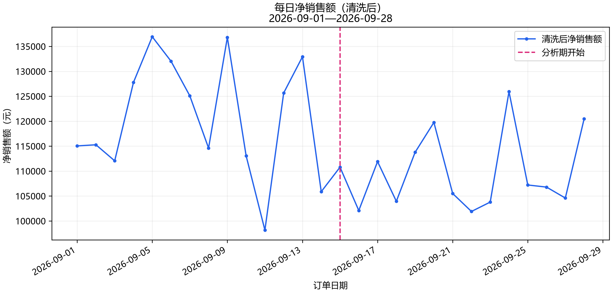
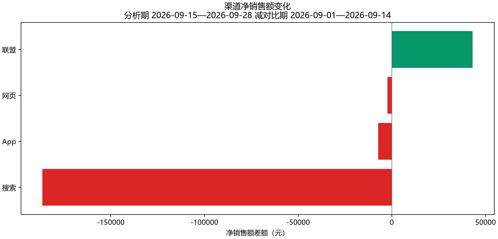
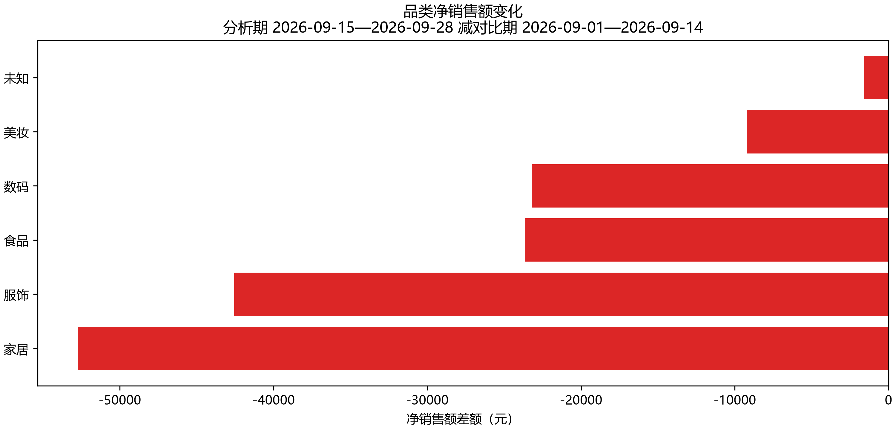
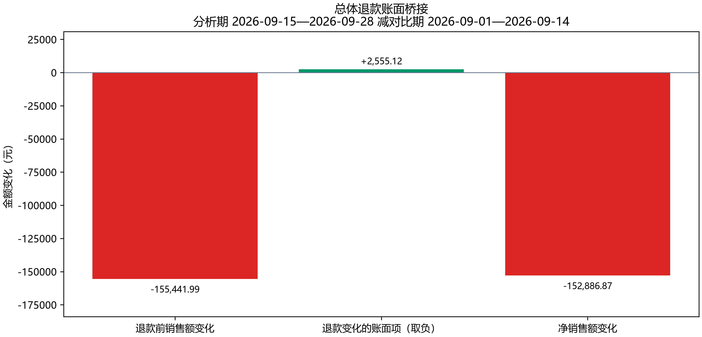
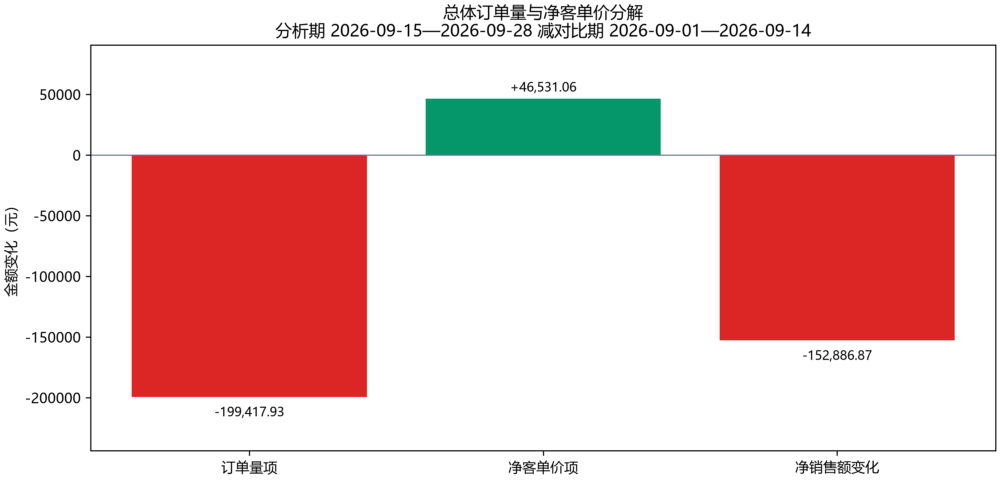
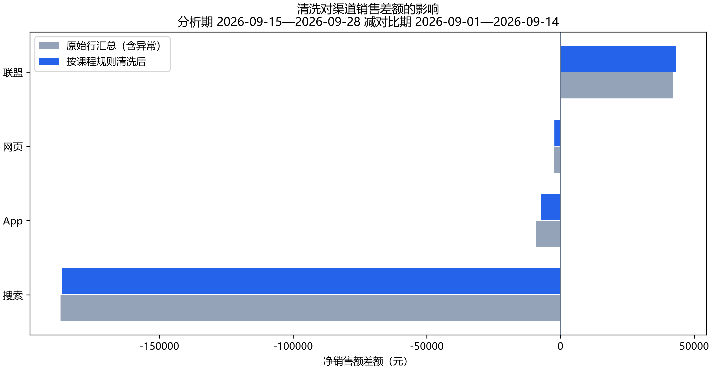
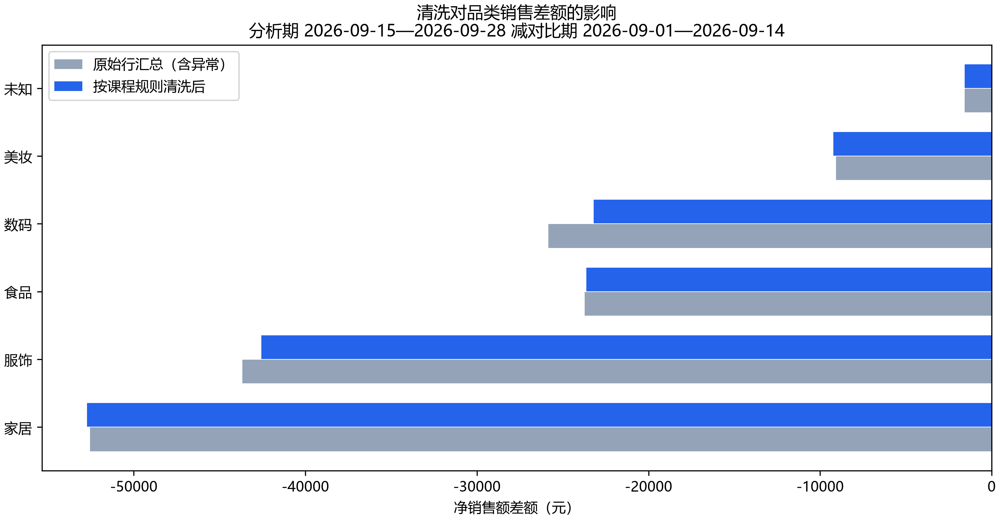

# 电商销售变化诊断报告

运行状态：**completed**。

对比期：2026-09-01 至 2026-09-14；分析期：2026-09-15 至 2026-09-28。金额单位为元。

## 总体变化

净销售额由 1,691,292.44 变为 1,538,405.57，差额 -152,886.87，变化率 -9.04%。证据：[总体指标](tables/overall.csv)、[结构化指标](metrics.json)。

| 指标 | 对比期 | 分析期 |
|---|---:|---:|
| 订单量（单） | 4,466.00 | 3,947.00 |
| 净客单价（元） | 378.70 | 389.77 |
| 金额退款率 | 2.58% | 2.67% |
| 退款前销售额（元） | 1,736,046.40 | 1,580,604.41 |
| 退款金额（元） | 44,753.96 | 42,198.84 |

## 渠道变化

证据：[分组表](tables/by_channel.csv)、[metrics.json](metrics.json) 的 by_channel。

| 分组 | 对比期 | 分析期 | 差额 | 下降贡献 |
|---|---:|---:|---:|---:|
| 搜索 | 466,340.76 | 279,932.48 | -186,408.28 | 121.93% |
| App | 591,002.89 | 583,700.70 | -7,302.19 | 4.78% |
| 网页 | 386,927.01 | 384,630.68 | -2,296.33 | 1.50% |
| 联盟 | 247,021.78 | 290,141.71 | 43,119.93 | -28.20% |

## 品类变化

证据：[分组表](tables/by_category.csv)、[metrics.json](metrics.json) 的 by_category。

| 分组 | 对比期 | 分析期 | 差额 | 下降贡献 |
|---|---:|---:|---:|---:|
| 家居 | 313,693.98 | 260,975.40 | -52,718.58 | 34.48% |
| 服饰 | 311,278.96 | 268,719.91 | -42,559.05 | 27.84% |
| 食品 | 134,344.44 | 110,720.35 | -23,624.09 | 15.45% |
| 数码 | 749,256.87 | 726,064.39 | -23,192.48 | 15.17% |
| 美妆 | 180,915.19 | 171,690.84 | -9,224.35 | 6.03% |
| 未知 | 1,803.00 | 234.68 | -1,568.32 | 1.03% |

## 渠道访客变化

跨天汇总为访客人次。订单数/访客人次不是用户级转化率。

证据：[访客表](tables/traffic.csv)。

| 渠道 | 对比期人次 | 分析期人次 | 差额 |
|---|---:|---:|---:|
| App | 20146 | 19816 | -330 |
| 搜索 | 17160 | 9909 | -7251 |
| 网页 | 14399 | 14130 | -269 |
| 联盟 | 11541 | 11418 | -123 |

## 指标变化的独立核算视角

以下是数学分解，不是业务因果效应。净客单价已包含退款；退款桥接与订单量—净客单价分解是不同视角，不能将两套分解项相加。展示金额四舍五入到分，分解项展示和可能存在 0.01 元舍入差，校验使用未提前舍入的值。

### 总体

退款前销售额变化 -155,441.99 元 − 退款金额变化 -2,555.12 元 = 净销售额变化 -152,886.87 元。

订单量项 -199,417.93 元 + 净客单价项 46,531.06 元 = 净销售额变化 -152,886.87 元。

### 最大下降渠道：搜索

退款前销售额变化 -192,300.13 元 − 退款金额变化 -5,891.85 元 = 净销售额变化 -186,408.28 元。

订单量项 -205,057.87 元 + 净客单价项 18,649.59 元 = 净销售额变化 -186,408.28 元。

### 最大下降品类：家居

退款前销售额变化 -51,165.15 元 − 退款金额变化 1,553.43 元 = 净销售额变化 -52,718.58 元。

订单量项 -38,127.50 元 + 净客单价项 -14,591.08 元 = 净销售额变化 -52,718.58 元。

## 数据质量

原始 10256 行，清洗后 10236 行。完全重复编号 12 个，冲突编号 4 个（隔离 8 行），未知商品 8 行。冲突原始行净额 2,473.28 元，不代表已确认交易损失。

| 时期 | 原始行净额 | 重复移除 | 去重后冲突移除 | 清洗净额 |
|---|---:|---:|---:|---:|
| control | 1,695,930.33 | 2,959.01 | 1,678.88 | 1,691,292.44 |
| analysis | 1,539,519.69 | 319.72 | 794.40 | 1,538,405.57 |

证据：[质量报告](quality_report.json)、[隔离明细](prepared/quarantined_items.csv)。

### 清洗是否改变下降来源判断

原始行汇总差额 -156,410.64 元；清洗后差额 -152,886.87 元；差额调整 3,523.77 元。原始行汇总包含异常，不代表真实交易额。

| 视角 | 原始行汇总的最大下降组 | 清洗后最大下降组 | 最大下降组改变 | 排名改变 |
|---|---|---|---|---|
| 渠道 | 搜索 | 搜索 | 否 | 否 |
| 品类 | 家居 | 家居 | 否 | 是 |

仅比较本次输入按既定规则清洗前后的账面汇总。原始行含重复/冲突，不是真实交易基准；来源未变不代表对其他异常普遍稳健。

证据：[清洗归因影响](attribution_impact.json)。

未知品类限制：未匹配商品金额保留为未知品类；已知品类排名不证明未知记录真实所属品类。

## Agent 选择的指标结论

新运行只接受受支持的结构化指标结论。数值与表述由程序从指标生成并记录具体字段；这不等于验证任意自然语言，也不证明业务因果。

- 总体净销售额由 1,691,292.44 元 变为 1,538,405.57 元，减少 152,886.87 元。（证据：[metrics](evidence_index.json)；字段：overall.control.net_sales、overall.analysis.net_sales）

- 总体订单量由 4,466 单 变为 3,947 单，减少 519 单。（证据：[metrics](evidence_index.json)；字段：overall.control.order_count、overall.analysis.order_count）

- 总体净客单价由 378.70 元 变为 389.77 元，增加 11.06 元。（证据：[metrics](evidence_index.json)；字段：overall.control.aov、overall.analysis.aov）

- 总体金额退款率由 2.58% 变为 2.67%，变化 +0.09 个百分点。（证据：[metrics](evidence_index.json)；字段：overall.control.refund_rate、overall.analysis.refund_rate）

- 总体退款前销售额变化为 -155,441.99 元，退款金额变化为 -2,555.12 元；按净销售额定义，前者减后者等于净销售额变化 -152,886.87 元。这是账面恒等关系，不能说明退款变化的业务原因。（证据：[metrics](evidence_index.json)；字段：overall.control.pre_refund_sales、overall.control.refund_amount、overall.control.net_sales、overall.analysis.pre_refund_sales、overall.analysis.refund_amount、overall.analysis.net_sales）

- 搜索渠道净销售额减少 186,408.28 元，占总体净销售额减少额的 121.93%，为最大下降渠道。（证据：[metrics](evidence_index.json)、[sql_001](evidence_index.json)；字段：by_channel.搜索.difference、by_channel.搜索.contribution、overall.difference）

- 搜索渠道订单量由 1,236 单 变为 706 单，减少 530 单。（证据：[metrics](evidence_index.json)、[sql_001](evidence_index.json)；字段：by_channel.搜索.control.order_count、by_channel.搜索.analysis.order_count）

- 搜索渠道净客单价由 377.30 元 变为 396.50 元，增加 19.21 元。（证据：[metrics](evidence_index.json)、[sql_001](evidence_index.json)；字段：by_channel.搜索.control.aov、by_channel.搜索.analysis.aov）

- 联盟渠道净销售额由 247,021.78 元 变为 290,141.71 元，增加 43,119.93 元。（证据：[metrics](evidence_index.json)；字段：by_channel.联盟.control.net_sales、by_channel.联盟.analysis.net_sales）

- 家居品类净销售额减少 52,718.58 元，占总体净销售额减少额的 34.48%，为最大下降品类。（证据：[metrics](evidence_index.json)、[sql_002](evidence_index.json)；字段：by_category.家居.difference、by_category.家居.contribution、overall.difference）

- 家居品类金额退款率由 1.70% 变为 2.60%，变化 +0.90 个百分点。（证据：[metrics](evidence_index.json)、[sql_002](evidence_index.json)；字段：by_category.家居.control.refund_rate、by_category.家居.analysis.refund_rate）

- 服饰品类净销售额由 311,278.96 元 变为 268,719.91 元，减少 42,559.05 元。（证据：[metrics](evidence_index.json)；字段：by_category.服饰.control.net_sales、by_category.服饰.analysis.net_sales）

清洗后每日净销售额；虚线标记分析期开始。

渠道拆解视角；红色减少、绿色增加。渠道与品类贡献不能相加。

品类拆解视角；红色减少、绿色增加。渠道与品类贡献不能相加。

退款前销售额变化减退款变化等于净销售额变化；不能说明退款的业务原因。

两因素对称分解；净客单价已包含退款，不与退款桥接各项再次相加。

原始行汇总仅用于展示异常影响，不是真实交易额或替代清洗口径。

原始行汇总仅用于展示异常影响，不是真实交易额或替代清洗口径。

## 边界与过程

渠道与品类是独立拆解视角，贡献不能相加；增长组贡献可为负，下降组可超过 100%。品类订单数不可相加。缺少广告、库存、竞品和用户级数据，指标变化不证明业务因果。

模型请求 8 次，工具调用 8 次，错误 0 次。详见 [调用轨迹](trace.jsonl)、[用量](usage.json)、[校验](validation.json)。
