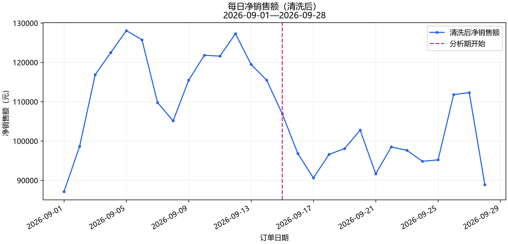
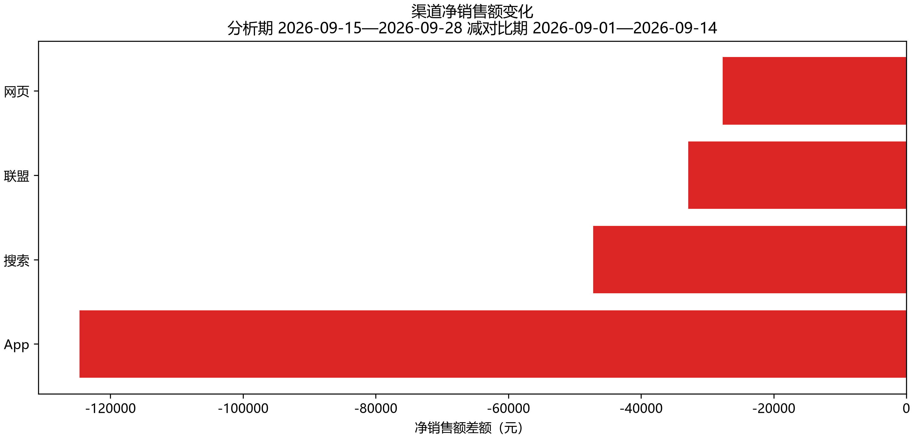
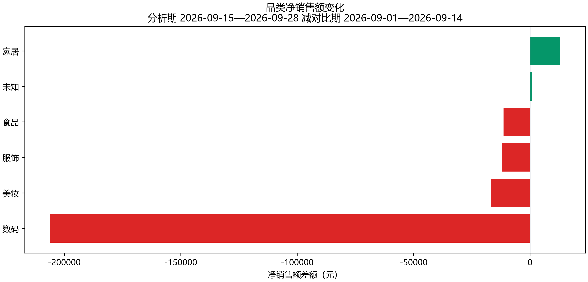
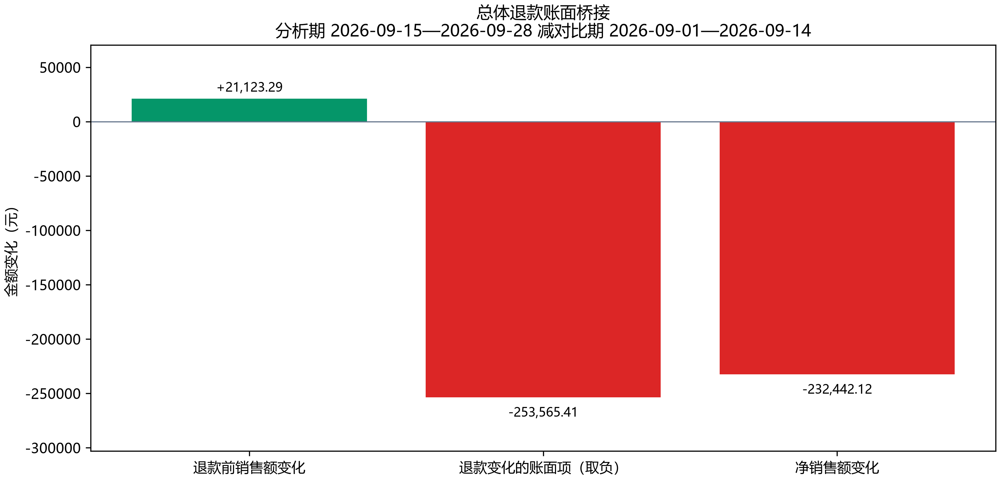
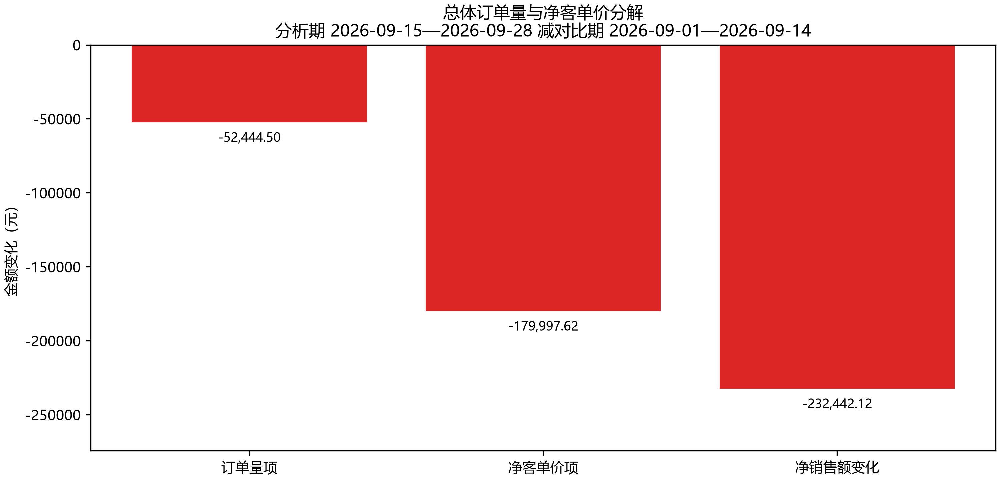
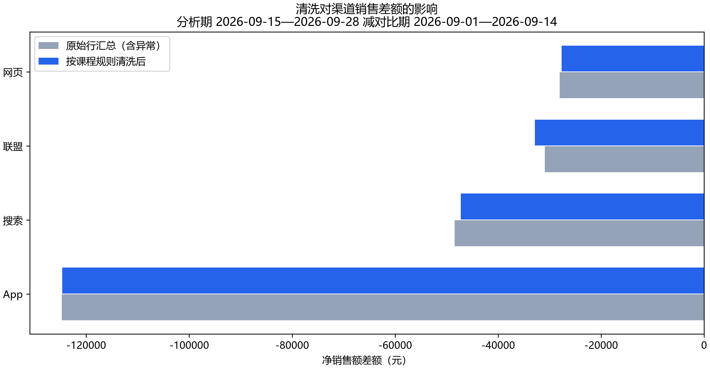
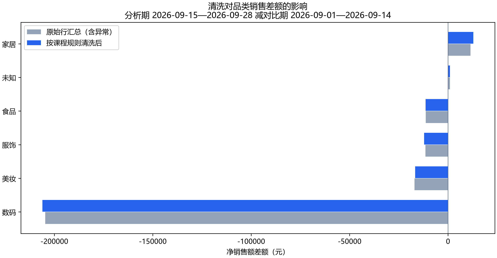

# 电商销售变化诊断报告

运行状态：**completed**。

对比期：2026-09-01 至 2026-09-14；分析期：2026-09-15 至 2026-09-28。金额单位为元。

## 总体变化

净销售额由 1,615,189.75 变为 1,382,747.63，差额 -232,442.12，变化率 -14.39%。证据：[总体指标](tables/overall.csv)、[结构化指标](metrics.json)。

| 指标 | 对比期 | 分析期 |
|---|---:|---:|
| 订单量（单） | 4,474.00 | 4,320.00 |
| 净客单价（元） | 361.02 | 320.08 |
| 金额退款率 | 2.73% | 17.77% |
| 退款前销售额（元） | 1,660,527.98 | 1,681,651.27 |
| 退款金额（元） | 45,338.23 | 298,903.64 |

## 渠道变化

证据：[分组表](tables/by_channel.csv)、[metrics.json](metrics.json) 的 by_channel。

| 分组 | 对比期 | 分析期 | 差额 | 下降贡献 |
|---|---:|---:|---:|---:|
| App | 583,224.92 | 458,580.82 | -124,644.10 | 53.62% |
| 搜索 | 426,673.57 | 379,436.05 | -47,237.52 | 20.32% |
| 联盟 | 250,699.63 | 217,832.67 | -32,866.96 | 14.14% |
| 网页 | 354,591.63 | 326,898.09 | -27,693.54 | 11.91% |

## 品类变化

证据：[分组表](tables/by_category.csv)、[metrics.json](metrics.json) 的 by_category。

| 分组 | 对比期 | 分析期 | 差额 | 下降贡献 |
|---|---:|---:|---:|---:|
| 数码 | 631,553.47 | 425,483.60 | -206,069.87 | 88.65% |
| 美妆 | 182,392.62 | 165,692.48 | -16,700.14 | 7.18% |
| 服饰 | 350,397.49 | 338,275.68 | -12,121.81 | 5.21% |
| 食品 | 97,277.65 | 85,911.21 | -11,366.44 | 4.89% |
| 未知 | 972.84 | 1,910.24 | 937.40 | -0.40% |
| 家居 | 352,595.68 | 365,474.42 | 12,878.74 | -5.54% |

## 渠道访客变化

跨天汇总为访客人次。订单数/访客人次不是用户级转化率。

证据：[访客表](tables/traffic.csv)。

| 渠道 | 对比期人次 | 分析期人次 | 差额 |
|---|---:|---:|---:|
| App | 20012 | 19968 | -44 |
| 搜索 | 17338 | 17086 | -252 |
| 网页 | 14039 | 14322 | 283 |
| 联盟 | 11394 | 11260 | -134 |

## 指标变化的独立核算视角

以下是数学分解，不是业务因果效应。净客单价已包含退款；退款桥接与订单量—净客单价分解是不同视角，不能将两套分解项相加。展示金额四舍五入到分，分解项展示和可能存在 0.01 元舍入差，校验使用未提前舍入的值。

### 总体

退款前销售额变化 21,123.29 元 − 退款金额变化 253,565.41 元 = 净销售额变化 -232,442.12 元。

订单量项 -52,444.50 元 + 净客单价项 -179,997.62 元 = 净销售额变化 -232,442.12 元。

### 最大下降渠道：App

退款前销售额变化 -41,685.06 元 − 退款金额变化 82,959.04 元 = 净销售额变化 -124,644.10 元。

订单量项 -46,033.92 元 + 净客单价项 -78,610.18 元 = 净销售额变化 -124,644.10 元。

### 最大下降品类：数码

退款前销售额变化 49,905.93 元 − 退款金额变化 255,975.80 元 = 净销售额变化 -206,069.87 元。

订单量项 31,340.33 元 + 净客单价项 -237,410.20 元 = 净销售额变化 -206,069.87 元。

## 数据质量

原始 10759 行，清洗后 10739 行。完全重复编号 12 个，冲突编号 4 个（隔离 8 行），未知商品 8 行。冲突原始行净额 2,912.18 元，不代表已确认交易损失。

| 时期 | 原始行净额 | 重复移除 | 去重后冲突移除 | 清洗净额 |
|---|---:|---:|---:|---:|
| control | 1,618,299.29 | 1,804.56 | 1,304.98 | 1,615,189.75 |
| analysis | 1,386,139.43 | 1,784.60 | 1,607.20 | 1,382,747.63 |

证据：[质量报告](quality_report.json)、[隔离明细](prepared/quarantined_items.csv)。

### 清洗是否改变下降来源判断

原始行汇总差额 -232,159.86 元；清洗后差额 -232,442.12 元；差额调整 -282.26 元。原始行汇总包含异常，不代表真实交易额。

| 视角 | 原始行汇总的最大下降组 | 清洗后最大下降组 | 最大下降组改变 | 排名改变 |
|---|---|---|---|---|
| 渠道 | App | App | 否 | 否 |
| 品类 | 数码 | 数码 | 否 | 否 |

仅比较本次输入按既定规则清洗前后的账面汇总。原始行含重复/冲突，不是真实交易基准；来源未变不代表对其他异常普遍稳健。

证据：[清洗归因影响](attribution_impact.json)。

未知品类限制：未匹配商品金额保留为未知品类；已知品类排名不证明未知记录真实所属品类。

## Agent 选择的指标结论

新运行只接受受支持的结构化指标结论。数值与表述由程序从指标生成并记录具体字段；这不等于验证任意自然语言，也不证明业务因果。

- 总体净销售额由 1,615,189.75 元 变为 1,382,747.63 元，减少 232,442.12 元。（证据：[metrics](evidence_index.json)；字段：overall.control.net_sales、overall.analysis.net_sales）

- 总体退款前销售额变化为 +21,123.29 元，退款金额变化为 +253,565.41 元；按净销售额定义，前者减后者等于净销售额变化 -232,442.12 元。这是账面恒等关系，不能说明退款变化的业务原因。（证据：[metrics](evidence_index.json)；字段：overall.control.pre_refund_sales、overall.control.refund_amount、overall.control.net_sales、overall.analysis.pre_refund_sales、overall.analysis.refund_amount、overall.analysis.net_sales）

- App渠道净销售额减少 124,644.10 元，占总体净销售额减少额的 53.62%，为最大下降渠道。（证据：[metrics](evidence_index.json)；字段：by_channel.App.difference、by_channel.App.contribution、overall.difference）

- App渠道金额退款率由 2.47% 变为 17.57%，变化 +15.10 个百分点。（证据：[metrics](evidence_index.json)、[sql_001](evidence_index.json)；字段：by_channel.App.control.refund_rate、by_channel.App.analysis.refund_rate）

- App渠道净客单价由 366.81 元 变为 315.18 元，减少 51.63 元。（证据：[metrics](evidence_index.json)、[sql_001](evidence_index.json)；字段：by_channel.App.control.aov、by_channel.App.analysis.aov）

- App渠道订单量由 1,590 单 变为 1,455 单，减少 135 单。（证据：[metrics](evidence_index.json)、[sql_001](evidence_index.json)；字段：by_channel.App.control.order_count、by_channel.App.analysis.order_count）

- App渠道商品数量由 2,286 件 变为 2,108 件，减少 178 件。（证据：[metrics](evidence_index.json)、[sql_003](evidence_index.json)；字段：by_channel.App.control.quantity、by_channel.App.analysis.quantity）

- 数码品类净销售额减少 206,069.87 元，占总体净销售额减少额的 88.65%，为最大下降品类。（证据：[metrics](evidence_index.json)；字段：by_category.数码.difference、by_category.数码.contribution、overall.difference）

- 数码品类退款前销售额变化为 +49,905.93 元，退款金额变化为 +255,975.80 元；按净销售额定义，前者减后者等于净销售额变化 -206,069.87 元。这是账面恒等关系，不能说明退款变化的业务原因。（证据：[metrics](evidence_index.json)、[sql_002](evidence_index.json)；字段：by_category.数码.control.pre_refund_sales、by_category.数码.control.refund_amount、by_category.数码.control.net_sales、by_category.数码.analysis.pre_refund_sales、by_category.数码.analysis.refund_amount、by_category.数码.analysis.net_sales）

- 数码品类金额退款率由 3.20% 变为 39.42%，变化 +36.22 个百分点。（证据：[metrics](evidence_index.json)、[sql_002](evidence_index.json)；字段：by_category.数码.control.refund_rate、by_category.数码.analysis.refund_rate）

- 数码品类净客单价由 628.41 元 变为 399.14 元，减少 229.27 元。（证据：[metrics](evidence_index.json)、[sql_002](evidence_index.json)；字段：by_category.数码.control.aov、by_category.数码.analysis.aov）

- 家居品类净销售额由 352,595.68 元 变为 365,474.42 元，增加 12,878.74 元。（证据：[metrics](evidence_index.json)；字段：by_category.家居.control.net_sales、by_category.家居.analysis.net_sales）

清洗后每日净销售额；虚线标记分析期开始。

渠道拆解视角；红色减少、绿色增加。渠道与品类贡献不能相加。

品类拆解视角；红色减少、绿色增加。渠道与品类贡献不能相加。

退款前销售额变化减退款变化等于净销售额变化；不能说明退款的业务原因。

两因素对称分解；净客单价已包含退款，不与退款桥接各项再次相加。

原始行汇总仅用于展示异常影响，不是真实交易额或替代清洗口径。

原始行汇总仅用于展示异常影响，不是真实交易额或替代清洗口径。

## 边界与过程

渠道与品类是独立拆解视角，贡献不能相加；增长组贡献可为负，下降组可超过 100%。品类订单数不可相加。缺少广告、库存、竞品和用户级数据，指标变化不证明业务因果。

模型请求 11 次，工具调用 11 次，错误 1 次。详见 [调用轨迹](trace.jsonl)、[用量](usage.json)、[校验](validation.json)。

错误与限制（含已恢复历史错误）：

- run_sql: 未知任务 'sql_traffic_visits'，请使用 workflow.ready_task_ids，或先 update_plan 注册新编号
