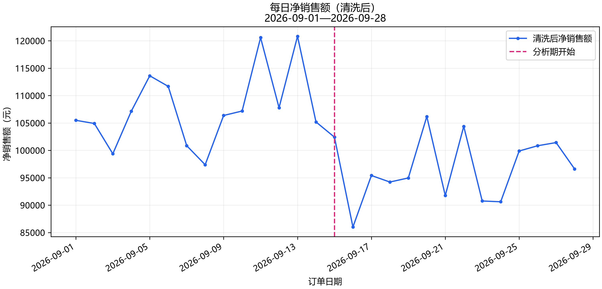
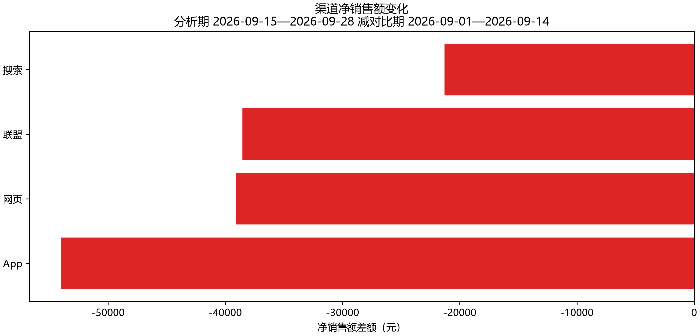
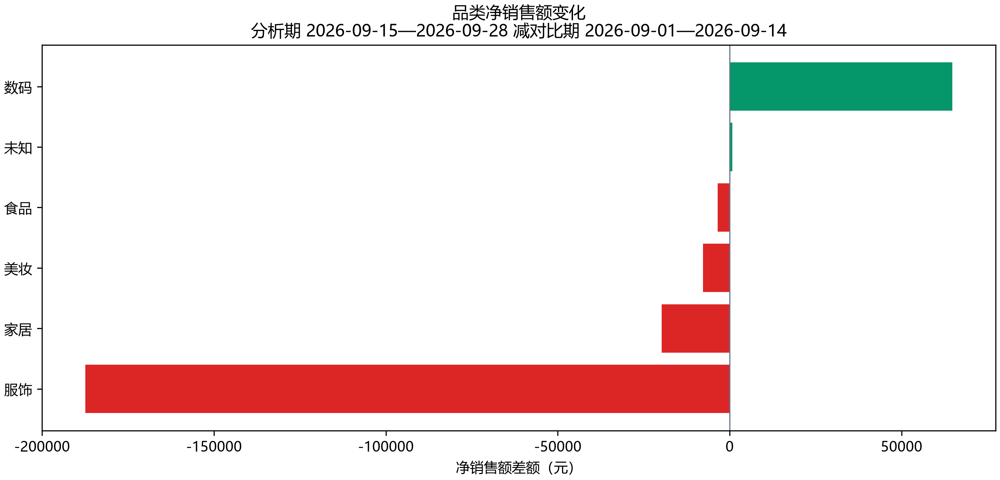
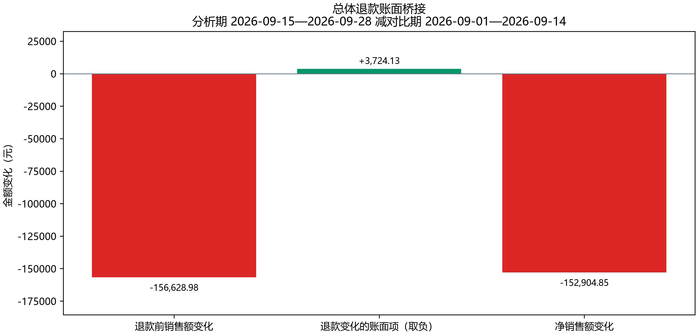
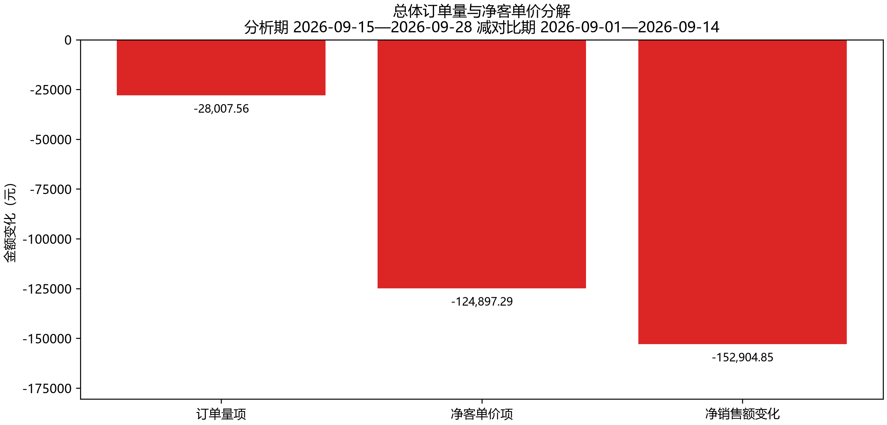
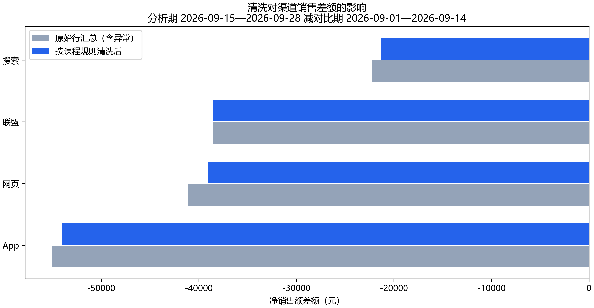
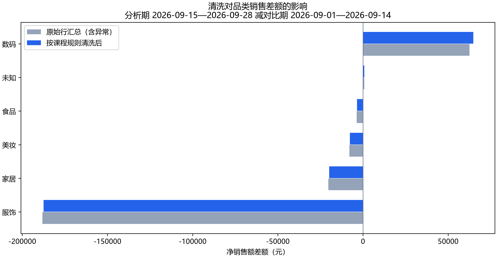

# 电商销售变化诊断报告

运行状态：**completed**。

对比期：2026-09-01 至 2026-09-14；分析期：2026-09-15 至 2026-09-28。金额单位为元。

## 总体变化

净销售额由 1,508,379.99 变为 1,355,475.14，差额 -152,904.85，变化率 -10.14%。证据：[总体指标](tables/overall.csv)、[结构化指标](metrics.json)。

| 指标 | 对比期 | 分析期 |
|---|---:|---:|
| 订单量（单） | 4,438.00 | 4,352.00 |
| 净客单价（元） | 339.88 | 311.46 |
| 金额退款率 | 2.78% | 2.82% |
| 退款前销售额（元） | 1,551,505.57 | 1,394,876.59 |
| 退款金额（元） | 43,125.58 | 39,401.45 |

## 渠道变化

证据：[分组表](tables/by_channel.csv)、[metrics.json](metrics.json) 的 by_channel。

| 分组 | 对比期 | 分析期 | 差额 | 下降贡献 |
|---|---:|---:|---:|---:|
| App | 525,128.99 | 471,114.40 | -54,014.59 | 35.33% |
| 网页 | 335,401.61 | 296,335.38 | -39,066.23 | 25.55% |
| 联盟 | 245,279.04 | 206,745.51 | -38,533.53 | 25.20% |
| 搜索 | 402,570.35 | 381,279.85 | -21,290.50 | 13.92% |

## 品类变化

证据：[分组表](tables/by_category.csv)、[metrics.json](metrics.json) 的 by_category。

| 分组 | 对比期 | 分析期 | 差额 | 下降贡献 |
|---|---:|---:|---:|---:|
| 服饰 | 258,732.37 | 71,296.43 | -187,435.94 | 122.58% |
| 家居 | 310,784.80 | 290,987.66 | -19,797.14 | 12.95% |
| 美妆 | 165,252.25 | 157,540.81 | -7,711.44 | 5.04% |
| 食品 | 113,757.46 | 110,243.69 | -3,513.77 | 2.30% |
| 未知 | 272.71 | 1,020.37 | 747.66 | -0.49% |
| 数码 | 659,580.40 | 724,386.18 | 64,805.78 | -42.38% |

## 渠道访客变化

跨天汇总为访客人次。订单数/访客人次不是用户级转化率。

证据：[访客表](tables/traffic.csv)。

| 渠道 | 对比期人次 | 分析期人次 | 差额 |
|---|---:|---:|---:|
| App | 19953 | 19759 | -194 |
| 搜索 | 17025 | 16742 | -283 |
| 网页 | 14411 | 14113 | -298 |
| 联盟 | 11574 | 11438 | -136 |

## 指标变化的独立核算视角

以下是数学分解，不是业务因果效应。净客单价已包含退款；退款桥接与订单量—净客单价分解是不同视角，不能将两套分解项相加。展示金额四舍五入到分，分解项展示和可能存在 0.01 元舍入差，校验使用未提前舍入的值。

### 总体

退款前销售额变化 -156,628.98 元 − 退款金额变化 -3,724.13 元 = 净销售额变化 -152,904.85 元。

订单量项 -28,007.56 元 + 净客单价项 -124,897.29 元 = 净销售额变化 -152,904.85 元。

### 最大下降渠道：App

退款前销售额变化 -54,501.02 元 − 退款金额变化 -486.43 元 = 净销售额变化 -54,014.59 元。

订单量项 4,310.96 元 + 净客单价项 -58,325.55 元 = 净销售额变化 -54,014.59 元。

### 最大下降品类：服饰

退款前销售额变化 -194,112.46 元 − 退款金额变化 -6,676.52 元 = 净销售额变化 -187,435.94 元。

订单量项 -11,951.95 元 + 净客单价项 -175,483.99 元 = 净销售额变化 -187,435.94 元。

## 数据质量

原始 10739 行，清洗后 10719 行。完全重复编号 12 个，冲突编号 4 个（隔离 8 行），未知商品 8 行。冲突原始行净额 3,506.26 元，不代表已确认交易损失。

| 时期 | 原始行净额 | 重复移除 | 去重后冲突移除 | 清洗净额 |
|---|---:|---:|---:|---:|
| control | 1,513,592.26 | 2,477.20 | 2,735.07 | 1,508,379.99 |
| analysis | 1,356,618.22 | 371.89 | 771.19 | 1,355,475.14 |

证据：[质量报告](quality_report.json)、[隔离明细](prepared/quarantined_items.csv)。

### 清洗是否改变下降来源判断

原始行汇总差额 -156,974.04 元；清洗后差额 -152,904.85 元；差额调整 4,069.19 元。原始行汇总包含异常，不代表真实交易额。

| 视角 | 原始行汇总的最大下降组 | 清洗后最大下降组 | 最大下降组改变 | 排名改变 |
|---|---|---|---|---|
| 渠道 | App | App | 否 | 否 |
| 品类 | 服饰 | 服饰 | 否 | 否 |

仅比较本次输入按既定规则清洗前后的账面汇总。原始行含重复/冲突，不是真实交易基准；来源未变不代表对其他异常普遍稳健。

证据：[清洗归因影响](attribution_impact.json)。

未知品类限制：未匹配商品金额保留为未知品类；已知品类排名不证明未知记录真实所属品类。

## Agent 选择的指标结论

新运行只接受受支持的结构化指标结论。数值与表述由程序从指标生成并记录具体字段；这不等于验证任意自然语言，也不证明业务因果。

- 总体净销售额由 1,508,379.99 元 变为 1,355,475.14 元，减少 152,904.85 元。（证据：[metrics](evidence_index.json)；字段：overall.control.net_sales、overall.analysis.net_sales）

- 总体退款前销售额变化为 -156,628.98 元，退款金额变化为 -3,724.13 元；按净销售额定义，前者减后者等于净销售额变化 -152,904.85 元。这是账面恒等关系，不能说明退款变化的业务原因。（证据：[metrics](evidence_index.json)；字段：overall.control.pre_refund_sales、overall.control.refund_amount、overall.control.net_sales、overall.analysis.pre_refund_sales、overall.analysis.refund_amount、overall.analysis.net_sales）

- App渠道净销售额减少 54,014.59 元，占总体净销售额减少额的 35.33%，为最大下降渠道。（证据：[metrics](evidence_index.json)、[sql_001](evidence_index.json)；字段：by_channel.App.difference、by_channel.App.contribution、overall.difference）

- 服饰品类净销售额减少 187,435.94 元，占总体净销售额减少额的 122.58%，为最大下降品类。（证据：[metrics](evidence_index.json)、[sql_002](evidence_index.json)；字段：by_category.服饰.difference、by_category.服饰.contribution、overall.difference）

- App渠道净客单价由 351.02 元 变为 312.20 元，减少 38.82 元。（证据：[metrics](evidence_index.json)、[sql_001](evidence_index.json)；字段：by_channel.App.control.aov、by_channel.App.analysis.aov）

- App渠道订单量由 1,496 单 变为 1,509 单，增加 13 单。（证据：[metrics](evidence_index.json)、[sql_001](evidence_index.json)；字段：by_channel.App.control.order_count、by_channel.App.analysis.order_count）

- 联盟渠道金额退款率由 2.35% 变为 2.95%，变化 +0.59 个百分点。（证据：[metrics](evidence_index.json)、[sql_001](evidence_index.json)；字段：by_channel.联盟.control.refund_rate、by_channel.联盟.analysis.refund_rate）

- 服饰品类净客单价由 216.88 元 变为 64.35 元，减少 152.53 元。（证据：[metrics](evidence_index.json)、[sql_002](evidence_index.json)；字段：by_category.服饰.control.aov、by_category.服饰.analysis.aov）

- 服饰品类退款金额由 8,935.90 元 变为 2,259.38 元，减少 6,676.52 元。（证据：[metrics](evidence_index.json)、[sql_002](evidence_index.json)；字段：by_category.服饰.control.refund_amount、by_category.服饰.analysis.refund_amount）

- 数码品类净销售额由 659,580.40 元 变为 724,386.18 元，增加 64,805.78 元。（证据：[metrics](evidence_index.json)；字段：by_category.数码.control.net_sales、by_category.数码.analysis.net_sales）

清洗后每日净销售额；虚线标记分析期开始。

渠道拆解视角；红色减少、绿色增加。渠道与品类贡献不能相加。

品类拆解视角；红色减少、绿色增加。渠道与品类贡献不能相加。

退款前销售额变化减退款变化等于净销售额变化；不能说明退款的业务原因。

两因素对称分解；净客单价已包含退款，不与退款桥接各项再次相加。

原始行汇总仅用于展示异常影响，不是真实交易额或替代清洗口径。

原始行汇总仅用于展示异常影响，不是真实交易额或替代清洗口径。

## 边界与过程

渠道与品类是独立拆解视角，贡献不能相加；增长组贡献可为负，下降组可超过 100%。品类订单数不可相加。缺少广告、库存、竞品和用户级数据，指标变化不证明业务因果。

模型请求 8 次，工具调用 8 次，错误 0 次。详见 [调用轨迹](trace.jsonl)、[用量](usage.json)、[校验](validation.json)。
