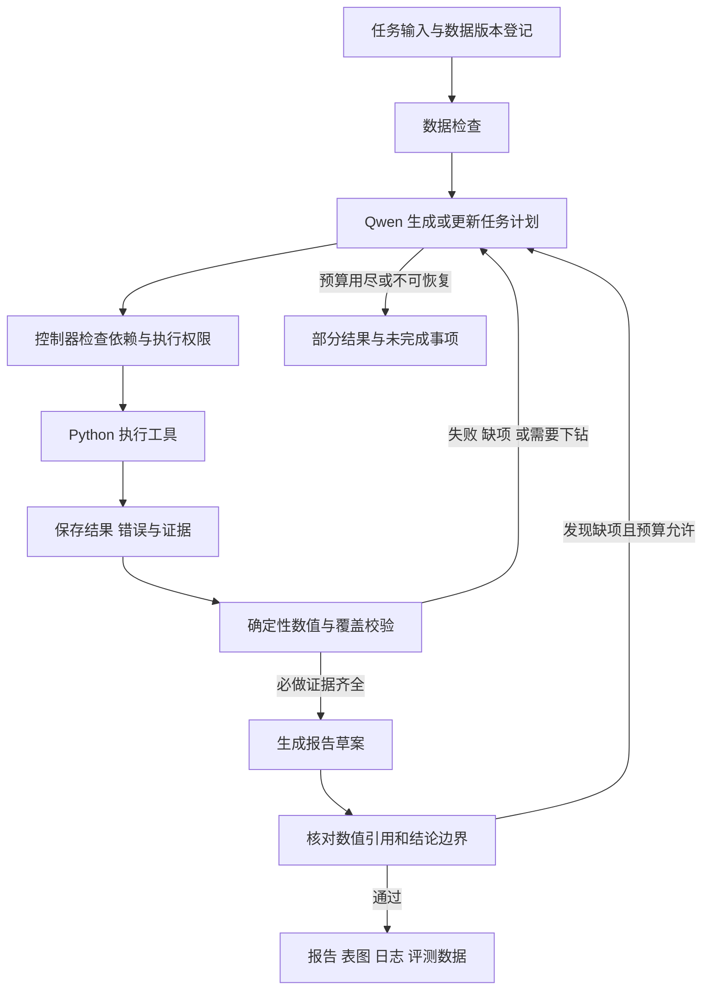

# 电商销售下降分析 Agent 互补架构规划

编制日期：2026-11-06。状态：设计方案，尚未实现或运行评测。正式课程 Word 是验收依据；本文的工具选型、预算、接口和扩展实验是实施建议。原资料和既有规划保留，本文补充与 CausaLens 的差异化设计。

## 1. 定位与依据

实现一个基于 Qwen 的经营诊断 Agent：接受三张业务表和比较时期，自主检查数据、组织分析、执行代码、读取反馈并修复错误，输出可核算的销售下降来源报告。

阅读依据：

- `课程大作业_完整材料/01_作业说明/课程大作业_电影推荐与数据分析.docx`：已核对原文中题目二和共同要求。
- 既有 `课题二正式说明摘录.md`、`数据说明与验收清单.md`、项目结构与评测规划。
- `E:/Projects/causalens-agent/README.md`、`src/causalens/agent/graph.py`、`state.py`、`nodes.py`。

当前工作区没有另一套 Agent 源码子目录，故将相邻工作区 `E:/Projects/causalens-agent` 作为用户所指的旧项目。该路径下已有 LangGraph 编排、研究配置检查与因果执行分支；README 描述了 RAG、统计估计和对话研究工作台。此次只检查其架构，不修改旧项目，不将历史文档中的测试数字视为本次验证结果。

课设目标是描述性归因：回答“少了多少钱、集中在哪里、哪些指标同步变化”。因果推断研究回答“干预是否造成结果变化”。二者可以衔接，但不能用销售分组贡献替代因果效应。

## 2. 与旧项目互补

| 维度 | CausaLens 已有方向 | 新项目设计方向 |
|---|---|---|
| 主要用户任务 | 交互探索与研究设计 | 一次任务完成经营异常诊断、支持批量案例 |
| 主要数据 | 用户提供的数据集及研究背景 | 订单明细、商品、流量三表 |
| 编排 | LangGraph 节点及条件路由 | 自建轻量 Plan–Execute–Replan 控制器与任务依赖表 |
| 决策展示 | 工具调用、变量配置、人工确认 | 计划版本、根据结果新增的下钻任务、错误修复 |
| 计算重点 | 描述统计与适用条件下的因果估计 | 财务口径、数据质量、渠道与品类贡献、指标分解 |
| 证据组织 | 工具记录与研究报告 | 每条结论绑定表格单元格、计算代码、数据版本 |
| 主要验收 | 研究配置有效性与方法适配 | 数值正确、金额守恒、任务覆盖、自动恢复 |
| 衔接 | 接受待验证研究问题 | 输出假设与缺失数据清单 |

代码层面的具体差异：旧项目 `nodes.py` 普通工具路径用 `remaining_tools[0]` 选择既定顺序中的下一工具，完成检查主要关注所需工具是否成功执行。新项目允许 Qwen 根据已见数据修改任务依赖与优先级，并以必做证据是否齐全、校验是否通过决定完成。这个差异属于项目实现选择，并非 LangGraph 本身不能动态规划。

## 3. 推荐架构

采用单 Agent 的“计划—执行—复核—重规划”，增加结构化证据账本。Planner、Executor、Verifier、Reporter 是模块职责，不代表四个独立聊天 Agent。第一版无需多 Agent 协商或额外编排框架。



### 3.1 任务计划

计划是机器可执行的任务表，不只是提示词里的步骤列表。每项至少包含：`task_id`、目标、依赖项、拟用工具、参数、预期证据、验收条件、状态和重试次数。计划修改保留版本与简短理由。

程序固定课程验收清单、指标定义和安全限制；Qwen 决定当前可执行任务、查询或代码、重点分组、下钻顺序及修复动作。模型不得删除必做要求。控制器检测循环依赖、未知工具、重复无效动作以及提前结束。

### 3.2 执行与复核

- 确定性计算库提供清洗和标准指标函数，模型可调用这些函数并编写组合分析代码。
- Executor 运行代码并返回结构化结果、异常类型、错误位置、耗时与产物引用。
- Verifier 独立检查数据粒度、数值守恒、证据覆盖和引用有效性；不能仅用另一次模型回答充当数值校验。
- Reporter 从已验证的表格填入数值，Qwen 负责组织解释、局限与后续核查建议。
- 结论区分“已计算事实”“指标解释”“待验证假设”；结构校验不能保证自然语言语义正确，最终实验报告仍需人工复核。

### 3.3 证据账本

每份证据保存 `evidence_id`、数据哈希、清洗版本、时期、分组、工具调用 ID、代码文件、结果文件、字段定位和校验状态。结论中的金额与比例引用具体证据，不只附整份 CSV 链接。

采用 JSONL 事件轨迹和 JSON 状态快照即可；不引入消息队列。中断恢复只复用与输入、配置和代码版本一致的已完成结果，对执行状态不明的任务进行核查或幂等重跑。重放历史结果与真实重新调用模型分开标记。

## 4. 技术栈与工具接口

| 组件 | 选择 | 用途 |
|---|---|---|
| 运行环境 | Python 3.12，独立虚拟环境 | 与旧项目环境习惯接近，但独立锁定依赖 |
| 模型 | 支持工具调用的 Qwen API | 生成计划、选择动作、修复代码和解释结果 |
| 编排 | 自建 Python 控制器 | 维护任务依赖、状态、预算与重规划 |
| 契约 | Pydantic | 校验计划、工具参数和结果结构 |
| 数据处理 | pandas；金额以整数分或 Decimal 表示 | 三表清洗、聚合、分组与关联 |
| 执行环境 | 隔离的 Python worker，优先容器 | 运行模型生成的代码，返回异常供修复 |
| 图表 | matplotlib | 趋势、渠道变化、品类变化 |
| 入口与配置 | argparse、JSON 或 TOML | CLI 运行、批量评测与配置 |
| 报告与记录 | Markdown、CSV、JSON、JSONL、PNG | 可读报告、机器可读结果与审计 |
| 验证 | pytest、独立评分脚本 | 关键口径、守恒、故障恢复与公开案例评分 |

Qwen 官方 Function Calling 文档描述了工具声明、模型返回调用、应用执行并回传工具结果的机制，可用于上述闭环：https://www.alibabacloud.com/help/en/model-studio/qwen-function-calling 。具体模型 ID、账户可用区域、接口和依赖版本在接入阶段确认并锁定；本文不承诺特定模型免费或账户有权限。

建议最小工具集：

| 工具 | 输入 | 输出 |
|---|---|---|
| `inspect_data` | 数据集 ID、表名、检查项 | 字段、类型、样本摘要、日期覆盖、缺失和主键异常 |
| `run_python` | 任务 ID、代码、已登记输入引用 | stdout、结构化结果、错误、产物 ID |
| `read_artifact` | 证据 ID、字段或行范围 | 有界结果片段，避免塞入完整数据 |
| `validate_evidence` | 证据 ID、规则集合 | 通过项、失败项、缺失证据 |
| `render_charts` | 已校验表 ID、图型、标签 | PNG 与图表元数据 |

控制器在每次执行后自动触发必要校验，模型不能跳过。图表和计算使用同一份证据表。无需同时实现 SQL 工具；Python 执行已满足课设。SQL、数据库服务、RAG、复杂前端列为后续扩展。

## 5. 业务分析如何实现

### 5.1 数据检查与清洗

原始数据只读。先检查三表结构、日期覆盖、字段类型、商品主键、流量复合主键及订单渠道一致性，然后按固定课程规则处理：

1. 按 `item_id` 判断全部字段一致性；完全重复只保留一条。
2. 同编号字段冲突时隔离该编号全部记录，报告编号数、行数和按原始行计算的排除金额。
3. 商品关联缺失时保留金额，品类设为“未知”。
4. 先按日期、渠道汇总订单，再与流量关联，验证不会重复放大访客数。
5. 保存原始行汇总、去重后、冲突隔离后的指标桥接。原始行汇总不解释为真实销售额，冲突排除金额不解释为已确认损失。

公开案例中的异常数量是评测预期，不写入清洗算法。缺少字段不能臆造；能计算的继续计算，不能计算的指标标记不可用。商品表主键或流量键冲突时，不任意取首行或求和，说明影响并停止相关指标，必要时请求补充数据。

### 5.2 必做指标

默认对比期 2026-09-01 至 09-14，分析期 09-15 至 09-28；输入支持显式配置并检查日期不重叠。

- 净销售额 = 原价金额 − 优惠金额 − 退款金额；金额已是整条明细金额，不能再乘数量。
- 订单量 = 清洗后去重订单编号数；客单价 = 净销售额 / 订单量。
- 退款率 = 退款金额 /（原价金额 − 优惠金额）。
- 差额 = 分析期 − 对比期；变化率 = 差额 / 对比期。
- 下降贡献 = 分组减少额 / 总减少额，仅在总体下降时报告该口径。
- 分母为零返回 null 并给原因；跨天访客累计单位为人次。

分别计算总体、渠道、品类、每日指标；渠道与品类差额各自加总等于总体差额。增长分组贡献为负，下降分组贡献可超过 100%，不截断、不强制归一成全正比例。品类订单数按包含该品类的订单去重，同一订单可出现在多个品类，不能相加还原总订单量。

### 5.3 动态下钻

完成基础比较后，模型基于证据选择重点：若渠道销售与访客均下降，检查订单/访客比和客单价；若品类退款率上升，比较退款金额与退款前销售额；若客单价下降，检查数量、成交单价与品类/商品结构。两个拆解视角始终是必做，模型只能调整先后和额外深度。

访问转化相关指标应命名为“订单数/访客人次”，说明统计口径，不将它冒充用户级转化概率。没有品类访客数据，不能推算真实品类转化率。

### 5.4 可选的指标分解

基础完成后增加两因素对称分解：令 S=N×A，N 为订单量、A 为净客单价。

`订单量项=(N1−N0)×(A0+A1)/2`

`客单价项=(A1−A0)×(N0+N1)/2`

两项严格还原销售差额；只在两期客单价均有定义时使用，计算阶段不提前舍入。这是数学分解，不是因果效应。退款已含在净客单价中，不把退款变化再与上述两项重复相加。退款另用“退款前销售额变化−退款金额变化=净销售额变化”的独立桥接视角解释。

## 6. 约束与完成条件

课程硬约束：6–8 人、两周、Qwen API、真实动态工具闭环、报错后修改重试、三组公开案例评测、关键表格、至少两图、课程报告和约 10 分钟展示。正式原文未给评分权重、统一容差或具体截止日，不自行编造。

工程建议：每次最多 20 次模型请求、30 次工具调用、单任务最多 2 次修复、代码执行超时 30 秒、总时长 10 分钟；这些是初始可配置值，联调后调整。重试计入总预算；API 返回用量据实记录，缺失时标记未知，不能伪装成零。429 或网络故障可有限退避，鉴权失败直接报告。

执行 worker 只读挂载选定三张 CSV，可写当次输出目录；禁网、限制资源、不传入 API 密钥。参考答案、生成脚本、旧项目、宿主目录不挂载。仅靠子进程、超时或 Python 字符串黑名单不是安全沙箱；若无法提供隔离环境，不在宿主上开放任意生成代码，采用明确标注能力受限的注册计算工具模式，不能声称已通过任意代码执行恢复验收。

完成必须同时满足：所有必做指标存在或明确不可用，两个维度守恒，质量影响已说明，至少两张图生成且标注完整，结论可回溯证据，日志与用量已保存。缺少关键必做项的运行返回 `partial`；致命错误返回 `failed`；无下降但必做检查完成可以返回 `completed`，同时明确没有下降。

## 7. 与 CausaLens 的衔接

新增可选 `research_handoff.json`，包含数据摘要、已观察事实、待验证假设、所需补充数据、证据引用和分析局限。例如“搜索渠道访客下降”可引出“投放策略改变是否影响访客”的研究问题，但当前没有投放与对照数据，不能自动执行 DiD 或 DML。

两周内只实现导出契约及示例，不要求修改旧项目或双系统联调。旧项目后续通过独立适配器导入，由其既有研究设计与人工确认流程处理。新项目不能把一个渠道标签自动当处理变量并承诺因果识别。

## 8. 评测与验收

公开案例必须全部真实运行，结果未运行前不填数值。参考答案只由独立评分进程读取。

| 项目 | 建议协议 |
|---|---|
| 关键数值正确率 | 容差内字段数 / 预先固定字段数；缺失字段判错 |
| 容差 | 金额 0.01 元；计数精确；比例统一单位并按预先约定精度比较 |
| 主要来源识别 | 渠道和品类分别计算命中率；机制另核对目标分组及指标证据 |
| 调用与资源 | 模型和工具调用分别记录，含失败与重试；记录 Token 与端到端耗时 |
| 动态过程 | 保存至少一个因观察结果改变任务的实例，以及错误—修复—成功轨迹 |
| 故障与边界 | 受控代码异常、缺字段、关联异常、重复流量键、无下降、零分母、超预算 |

受控故障运行单列，不混入正常案例性能统计；测试副本不得改动原始材料。预算允许时每案例运行三次，报告均值、范围和失败次数。可选比较“固定分析脚本”与 Agent 的正确性、恢复和成本；这不是题目二的强制消融实验。

核心计算目标是公开案例数值全对、分组守恒和三案例来源识别通过；这些是验收目标，不是已取得成绩。另用小型手算样例验证口径，避免评分与计算共享同一错误实现。

## 9. 两周实施与分工

| 时间 | 任务 | 可验收产物 |
|---|---|---|
| 第 1–2 天 | 确认口径、工具契约、运行与隔离环境 | 数据检查、手算样例、Qwen 最小工具调用 |
| 第 3–4 天 | 清洗、指标与守恒校验 | 可独立运行的确定性分析内核 |
| 第 5–7 天 | 计划、执行、重规划和代码修复 | 一个案例的真实 Agent 闭环 |
| 第 8–9 天 | 证据、表图与报告 | 单案例完整证据包 |
| 第 10–11 天 | 三案例、故障恢复与边界评测 | 评测汇总和失败分析 |
| 第 12–14 天 | 回归、复现、课程报告与演示 | 可提交包及 10 分钟展示材料 |

若沿用现有八人规划：A 统筹与验收口径；B 数据检查清洗；C 指标拆解；D 控制器与模型接入；E 隔离执行与恢复；F 图表报告；G 评测与边界；H 文档集成和演示。六人时合并 A/H、F/G。每项分工都以实际提交及验收证据记录贡献。

P0：课设硬要求和真实闭环。P1：对称分解、断点恢复、假设交接契约。P2：交互界面、多 Agent、更多外部数据。先保证 P0，不用前端或框架复杂度替代验收能力。

## 10. 项目与输出结构

建议源码模块：`controller/`（计划、调度、预算）、`tools/`（检查和执行）、`analysis/`（清洗、指标、拆解）、`verification/`（守恒和覆盖）、`evidence/`（登记和引用）、`reporting/`（图表和报告）、`evaluation/`（隔离评分）。原始资料目录保持不变。

每次运行输出：

```text
outputs/<run_id>/
  report.md
  metrics.json
  quality_report.json
  tables/overall.csv
  tables/by_channel.csv
  tables/by_category.csv
  tables/daily.csv
  tables/quality_bridge.csv
  tables/quarantined_items.csv
  charts/daily_net_sales.png
  charts/channel_delta.png
  charts/category_delta.png
  evidence_index.json
  plan_versions.jsonl
  trace.jsonl
  code/
  usage.json
  manifest.json
  research_handoff.json          # 可选扩展
```

业务报告依次回答总体下降、主要渠道、主要品类、订单量/客单价/退款/访客变化、数据质量影响、局限和待核查事项。建议三张图覆盖趋势及两个拆解视角，最低要求仍为两张。

课程交付包含源码与依赖锁定、配置示例、三案例证据包、评测汇总、异常恢复案例、复现说明、课程总报告和约 10 分钟演示材料。报告围绕成员分工、目标、方法、结果和反思；演示建议目标 1 分钟、架构 2 分钟、真实案例 3 分钟、错误恢复 1 分钟、评测 2 分钟、局限 1 分钟。

开工时待落实的是账户可用模型及预算、实际成员和截止日、容器环境是否可用。这些不会阻碍当前架构规划，但接入和排期时必须落实。
